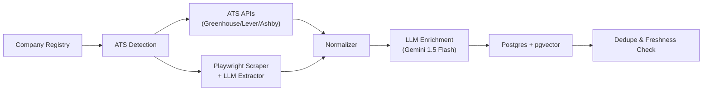
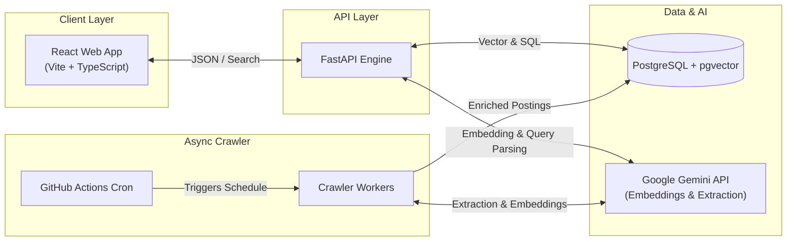
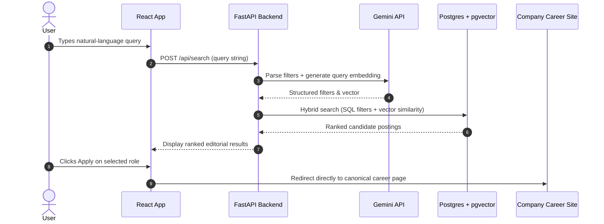

# Sift

> Find the jobs and internships that never make it to LinkedIn.

[](LICENSE)
[](https://www.python.org/downloads/)
[](https://fastapi.tiangolo.com)
[](https://www.postgresql.org/)
[](https://github.com/pgvector/pgvector)

---

## Why Sift

- **Hidden jobs**: Early-stage startups, high-growth engineering teams, and niche labs post directly to their own ATS—never paying to list on LinkedIn.
- **Scattered career pages**: Thousands of career portals (Greenhouse, Lever, Ashby, custom portals) are fragmented across the web with zero unified discovery.
- **No unified search**: Keyword search fails when you want semantic queries like *"Distributed systems role with Rust or Go paying >$180k with visa sponsorship"*.

---

## How It Works

Sift regularly indexes official company career portals and public ATS endpoints, normalizes unstructured postings, extracts structured attributes via Gemini, and indexes them for hybrid vector and relational retrieval.



---

## Architecture

The system splits into a scheduled async crawler worker and a high-performance synchronous search engine.



---

## Search Flow

Queries are parsed into semantic intent and structured constraints, evaluated with hybrid search, and linked directly to original application forms.



---

## Features

- **Natural-Language Search**: Query in human terms (e.g., *"Junior machine learning engineer working on LLM inference in NYC or remote"*).
- **Structured Faceted Filters**: Fine-grained filtering by role family, employment type, internship duration, experience band, and location.
- **Direct Apply Links**: Zero intermediary apply forms; every link redirects straight to the original Greenhouse, Lever, Ashby, or company portal.
- **Freshness & Ghost Job Tracking**: Regular re-verification archives expired postings and flags stale listings.
- **Saved Roles**: Local bookmarking for tracking active applications without invasive account creation.

---

## Tech Stack

| Component | Technology | Rationale |
| :--- | :--- | :--- |
| **Backend Framework** | FastAPI (Python 3.11+) | Async I/O for high-concurrency ingestion and rapid search API responses |
| **Database & Vector** | PostgreSQL 16 + pgvector (SQLite for dev) | Single source of truth combining relational ACID transactions with vector similarity |
| **LLM & Embeddings** | Google Gemini (1.5 Flash / Text Embedding 004) | High throughput, generous context window, cost-effective structured entity extraction |
| **Web Crawling** | HTTPX + BeautifulSoup4 + Playwright | Polite async crawling, rate-limiting, and JS rendering when required |
| **Frontend** | React + TypeScript + Vanilla CSS | High-performance, editorial aesthetic following strict design tokens (no heavy bloated CSS) |
| **Package Manager** | `uv` (Python) & `npm` (Node) | Ultra-fast reproducible builds and dependency synchronization |
| **Orchestration** | GitHub Actions Cron | Scheduled crawler triggers and freshness checks |

---

## Project Structure

```text
sift/
├── .github/
│   └── workflows/              # Scheduled crawler cron and CI checks
├── docs/
│   └── design-system.md        # Single source of truth for UI tokens & crawler ethics
├── backend/
│   ├── app/
│   │   ├── crawler/            # Polite crawler core, rate-limiter & robots parser
│   │   │   ├── connectors/     # Greenhouse, Lever, Ashby, and custom scrapers
│   │   │   ├── client.py       # Polite HTTP client with per-domain rate limiting
│   │   │   ├── rate_limiter.py # Token bucket domain throttling
│   │   │   ├── robots.py       # Async robots.txt compliance checker
│   │   │   └── schemas.py      # Raw & Normalized job Pydantic models
│   │   ├── enrichment/         # LLM structured extraction & embedding generation
│   │   ├── db/                 # Database models, pgvector migrations & session
│   │   ├── search/             # Natural-language query parser & hybrid search
│   │   ├── api/                # FastAPI routes (/api/search, /api/jobs, /api/apply)
│   │   ├── config.py           # Strongly typed settings & domain guardrails
│   │   └── main.py             # ASGI entrypoint
│   ├── tests/                  # Pytest test suite
│   └── pyproject.toml          # uv backend project definition
├── frontend/                   # React + TypeScript editorial interface
├── .env.example                # Safe environment variable template
├── .gitignore
├── LICENSE                     # MIT License
└── README.md
```

---

## Getting Started

### Prerequisites

- **Python**: 3.11 or later with [`uv`](https://github.com/astral-sh/uv) installed (`curl -LsSf https://astral.sh/uv/install.sh | sh`)
- **Node.js**: v20 or later
- **PostgreSQL**: 15+ with `pgvector` extension (or use embedded SQLite for local development)
- **Gemini API Key**: Obtain a key from [Google AI Studio](https://aistudio.google.com/)

### 1. Environment Setup

Clone the repository and copy the environment template:

```bash
git clone https://github.com/AdityaSurse/sift.git
cd sift
cp .env.example .env
```

Edit `.env` to configure your API keys and crawler settings:

```env
SIFT_ENV=development
SIFT_DATABASE_URL=sqlite+aiosqlite:///./data/sift.db
GEMINI_API_KEY=your_gemini_api_key_here
SIFT_CRAWLER_USER_AGENT="SiftBot/1.0 (+https://siftjobs.com/bot; crawler@siftjobs.com)"
```

### 2. Run the Backend

```bash
cd backend
uv sync --extra dev
uv run uvicorn app.main:app --reload --port 8000
```

Verify backend health at `http://localhost:8000/health`.

### 3. Run the Frontend

```bash
cd ../frontend
npm install
npm run dev
```

The editorial search interface will be available at `http://localhost:5173`.

### 4. Run a Sample Crawl

Trigger a polite crawl against a test company board:

```bash
cd backend
uv run python -m app.crawler.cli --company stripe --ats greenhouse
```

---

## Roadmap

- [x] **Phase 0: Architecture, Design System & Project Scaffolding**
  - Design tokens, typography rules, crawler manifesto (`docs/design-system.md`)
  - Settings validation, domain blacklisting, environment guards
- [ ] **Phase 1: Polite Crawler Core & ATS Connectors**
  - Token-bucket domain rate limiter and robots.txt cache
  - Greenhouse, Lever, and Ashby job board API connectors
  - Canonical job schema (`NormalizedJob`)
- [ ] **Phase 2: LLM Enrichment Pipeline**
  - Structured extraction for salary bands, seniority, tech stack, and visa sponsorship
  - 2-sentence editorial summary generation
- [ ] **Phase 3: Storage & Vector / Hybrid Search**
  - Relational schema with vector embeddings indexing
  - Natural-language query translation and hybrid ranking algorithm
- [ ] **Phase 4: Search & Redirect API Service**
  - `/api/search` with structured facet filters and semantic match
  - Clean redirect tracking to canonical ATS apply pages
- [ ] **Phase 5: Editorial Frontend Interface**
  - Typographic, calm UI built strictly to design tokens
  - Fast keyboard shortcuts (`⌘K`), split reader pane, zero bloated shadows
- [ ] **Phase 6: End-to-End Orchestration & Verification**
  - Scheduled crawler runs, freshness verification, and automated testing

---

## Crawling Ethics

Sift is committed to being an exemplary web citizen:

1. **Strict Robots.txt Adherence**: Every domain's `robots.txt` is fetched, parsed, and cached. Any disallowed path is skipped immediately.
2. **Per-Domain Rate Limiting**: Minimum delay of 1.5 seconds between requests to the same host with a strict concurrency limit of 1.
3. **No Closed-Network Scraping**: Sift **never** scrapes LinkedIn, Indeed, Glassdoor, or walled gardens. We only index public ATS feeds and official career endpoints.
4. **Transparent Identity**: All HTTP requests are identified by `User-Agent: SiftBot/1.0 (+https://siftjobs.com/bot; crawler@siftjobs.com)`.
5. **Zero Intermediary Locking**: Apply links always redirect users directly to the original career portal. We never capture applicant data or lock jobs behind accounts.

---

## License

This project is licensed under the [MIT License](LICENSE).
