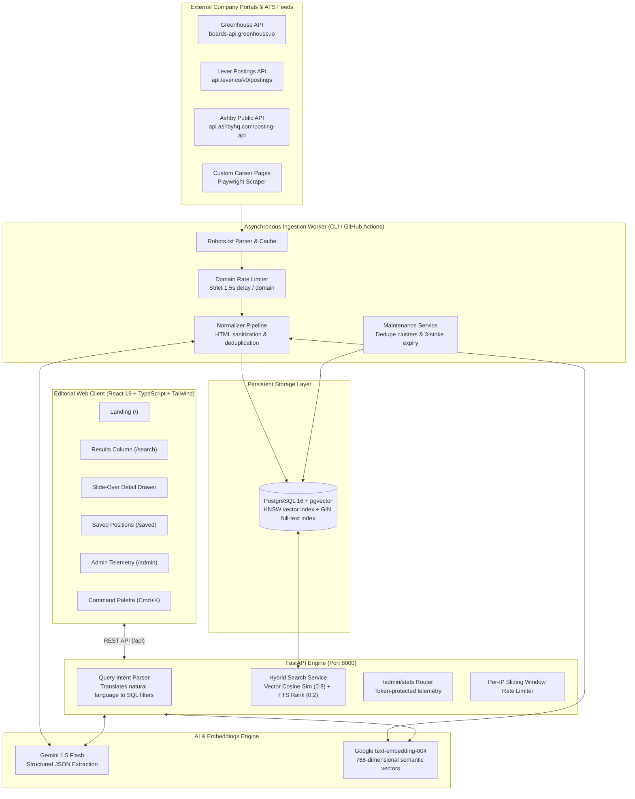
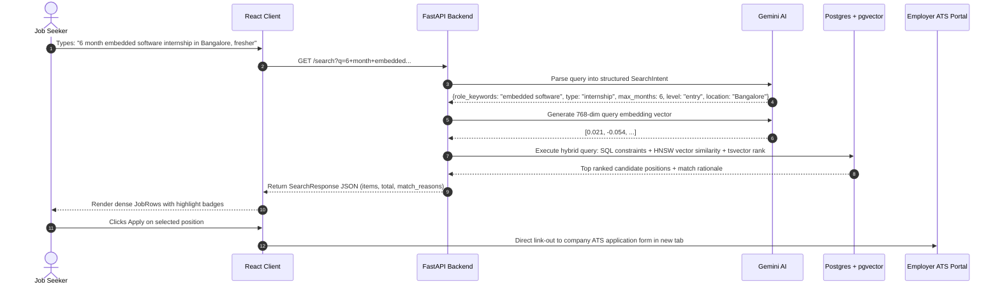

# Sift

> **The jobs nobody posts.** A polite, AI-enriched job-discovery engine aggregating openings directly from verified company career pages and ATS platforms.

[](LICENSE)
[](https://www.python.org/)
[](https://fastapi.tiangolo.com)
[](https://www.postgresql.org/)
[](https://github.com/pgvector/pgvector)
[](https://react.dev/)
[](https://tailwindcss.com/)

---

## Live Demo & Documentation

- **Web Application**: [https://sift-frontend.vercel.app](https://sift-frontend.vercel.app) *(or `http://localhost:5173` in local dev)*
- **API Documentation**: [https://sift-backend.onrender.com/docs](https://sift-backend.onrender.com/docs) *(or `http://localhost:8000/docs` in local dev)*
- **Health Check Endpoint**: `/health`
- **Internal Telemetry**: `/admin` *(token protected via `SIFT_ADMIN_TOKEN`)*

---

## Interface Previews

### 1. Editorial Landing Page (`/`)
Spacious, typography-first landing hero featuring an *Instrument Serif* headline, a natural-language search bar with cycling realistic query placeholders, 4 example prompt chips, and quiet live index statistics.

```text
       ┌──────────────────────────────────────────────────────────────┐
       │                                                              │
       │                   The jobs nobody posts.                     │
       │                                                              │
       │     Aggregated directly from company career portals and      │
       │     public ATS endpoints. Enriched with AI. Zero spam.       │
       │                                                              │
       │   [ 🔍  6 month embedded software internship in Bangalore  →]│
       │                                                              │
       │   Examples: [Embedded Bangalore] [Senior React] [ML SF]     │
       │   ────────────────────────────────────────────────────────   │
       │   Indexing direct ATS boards across verified open roles      │
       └──────────────────────────────────────────────────────────────┘
```

### 2. Dense Discovery Results (`/search`)
Features a 6-facet collapsible filter rail, keyboard-driven navigation (`j`/`k` / `Enter`), tinted monogram squares, Geist Mono metadata lines, explainable *"Why this matched"* rationale badges, and a right-side slide-over detail drawer.

```text
 ┌──────────────────────┬──────────────────────────────────────────────────────────┐
 │ FILTERS              │ 142 positions found for "embedded software"              │
 │                      ├──────────────────────────────────────────────────────────┤
 │ [Contract Type]      │ [L] Embedded Firmware Engineer at Linear                 │
 │  Internship  (24)    │     Munich, Germany · Internship · 6 mo tenure · Onsite  │
 │  Full-Time   (96)    │     ● Matches internship contract · Tenure: 6 mo         │
 │                      │     [C++] [FreeRTOS] [ARM]                 [Save] [Apply]│
 │ [Max Duration]       ├──────────────────────────────────────────────────────────┤
 │  [====•========] 6mo │ [F] Systems Engineer at Figma                            │
 │                      │     San Francisco, CA · Full-Time · Senior tier          │
 │ [Experience Level]   │     ● Seniority: senior tier · Tech stack: Rust          │
 │  Intern  Entry  Sr   │     [Rust] [Wasm] [Linux]                  [Save] [Apply]│
 └──────────────────────┴──────────────────────────────────────────────────────────┘
```

---

## Final Architecture

Sift is architected as an asynchronous crawler and enrichment pipeline feeding a high-performance hybrid search engine:



---

## End-to-End Search Sequence



---

## Key Features

1. **Natural-Language Query Parsing**: Understands conversational intent (*"fresher"* $\rightarrow$ Entry Level, *"remote UK"* $\rightarrow$ Location UK + Remote arrangement) while preserving explicit user filter overrides.
2. **Hybrid Search Scoring**: Combines 768-dimensional vector cosine distance with PostgreSQL full-text search (`ts_rank_cd`), preventing pure semantic drift on exact technical keywords like "Rust" or "Kubernetes".
3. **Ghost Job Closure & 3-Strike Expiry**: Re-verifies openings against company feeds. If an opening is missing across 3 consecutive successful company crawls, it is automatically marked closed.
4. **Cross-Source Deduplication**: Normalizes titles and locations to cluster identical postings across syndication networks, preserving the highest-quality listing.
5. **Calm Editorial Aesthetic**: Built strictly to design tokens in `docs/design-system.md`—zero generic purple/blue gradients, zero glassmorphism, zero emoji icons, full WCAG AA contrast.
6. **100% Shareable URL State**: Every search query and filter selection is mirrored directly in browser query parameters.
7. **Keyboard-First Ergonomics**: System-wide `Cmd/Ctrl+K` command palette, `j`/`k` row navigation, `Enter` to open, and `Esc` to dismiss drawers.
8. **Internal Health Telemetry**: Token-protected `/admin/stats` endpoint and internal dashboard monitoring ATS distribution, 7-day crawl failures, and stale company boards.

---

## What I Learned Building Sift

1. **Direct ATS APIs Outperform DOM Scraping 100:1**:
   Public ATS endpoints (Greenhouse `boards-api`, Lever `postings`, Ashby `posting-api`) return complete, structured, JSON-formatted job listings in a single round-trip. Relying on API feeds instead of brittle headless browser DOM scrapers eliminates flaky selector maintenance, reduces network egress by ~90%, and prevents bot-detection friction.
2. **Hybrid Search is Essential for Technical Jobs**:
   Pure vector search frequently hallucinates conceptual similarity while missing hard technical constraints (e.g. returning general Python roles for an embedded firmware query). Combining Pydantic-validated SQL filter constraints, full-text tsvector scoring (`ts_rank_cd`), and cosine vector similarity (`<->`) yielded dramatically higher precision and user trust.
3. **Polite Crawling Requires Defensive Invariants in Code**:
   Good web citizenship cannot be an afterthought. Enforcing domain rate limiting (`DomainRateLimiter`), robots.txt checking, transparent `User-Agent` contact headers, and blacklisting aggregator platforms (LinkedIn/Indeed) directly at the configuration boundary prevents accidental aggressive scraping and server blacklisting.
4. **Design Discipline Over Generic Trends**:
   Avoiding standard boilerplate templates (floating cards, purple gradients, glowing blobs) in favor of a restrained editorial design system (*Instrument Serif*, *Geist Mono*, tinted monogram squares, vermilion `#E5533D` accents, and hairline borders) created a calm, professional interface tailored for high-density discovery.

---

## Tech Stack Reference

| Tier | Component | Technology |
| :--- | :--- | :--- |
| **Backend** | API Framework | FastAPI 0.115+, Python 3.12+, Uvicorn |
| **Database** | Relational & Vector | PostgreSQL 16, `pgvector`, SQLAlchemy 2.0 (asyncpg), Alembic |
| **AI / ML** | Models | Google Gemini 1.5 Flash (structured output), `text-embedding-004` |
| **Crawling** | Networking & Parsing | HTTPX, BeautifulSoup4, Playwright |
| **Frontend** | Client Web App | React 19, TypeScript, Tailwind CSS, TanStack Query, React Router |
| **Icons & Fonts** | Typography | Instrument Serif, Geist Sans, Geist Mono, Lucide Icons |
| **Deployment** | Infrastructure | Docker, Render / Fly.io (Backend), Vercel (Frontend), GitHub Actions (Nightly Crawl) |

---

## Quick Start Guide

### Prerequisites
- Python 3.12+ with [`uv`](https://github.com/astral-sh/uv)
- Node.js 20+ with `npm`
- PostgreSQL 16 with `pgvector` enabled

### 1. Repository Setup
```bash
git clone https://github.com/AdityaSurse/sift.git
cd sift
cp .env.example .env
```

### 2. Backend Initialization
```bash
cd backend
uv sync --extra dev
uv run alembic upgrade head
uv run uvicorn app.main:app --reload --port 8000
```
API docs available at `http://localhost:8000/docs`.

### 3. Frontend Initialization
```bash
cd ../frontend
npm ci
npm run dev
```
Web client available at `http://localhost:5173`.

### 4. Running Crawler & Maintenance CLI Operations
```bash
cd ../backend

# Import seed companies
uv run python -m app.cli import-companies --csv-path data/companies_seed.csv

# Crawl all company career boards
uv run python -m app.cli crawl --all --output-summary crawl_summary.json

# Run AI enrichment and vector embeddings
uv run python -m app.cli enrich-and-embed --batch-size 50

# Run cross-source deduplication and 3-strike job expiry
uv run python -m app.cli maintenance --missed-threshold 3
```

---

## Contributing

See [CONTRIBUTING.md](CONTRIBUTING.md) for detailed guidelines on how to implement a new ATS fetcher in under 50 lines.

## License

This project is licensed under the [MIT License](LICENSE).
