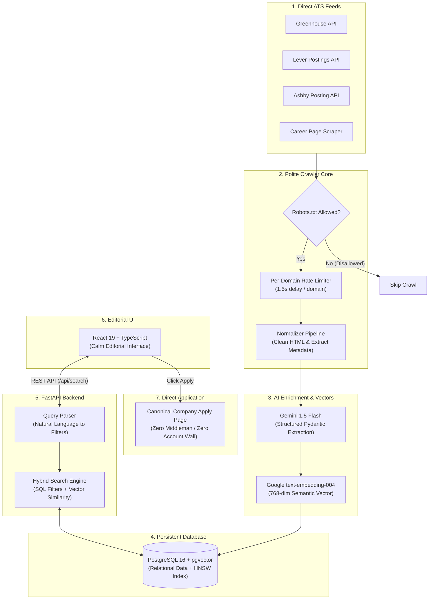
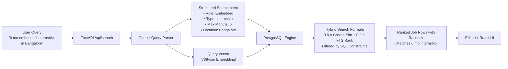
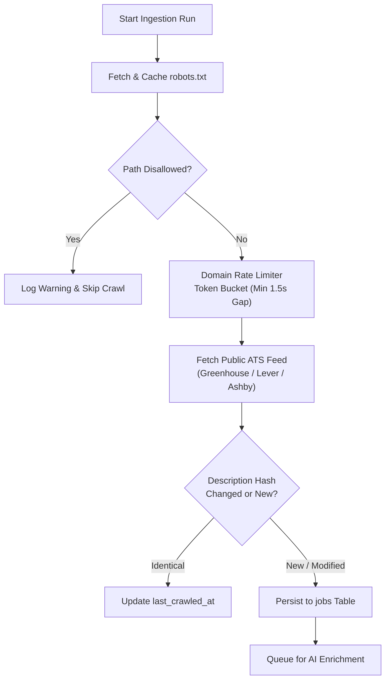
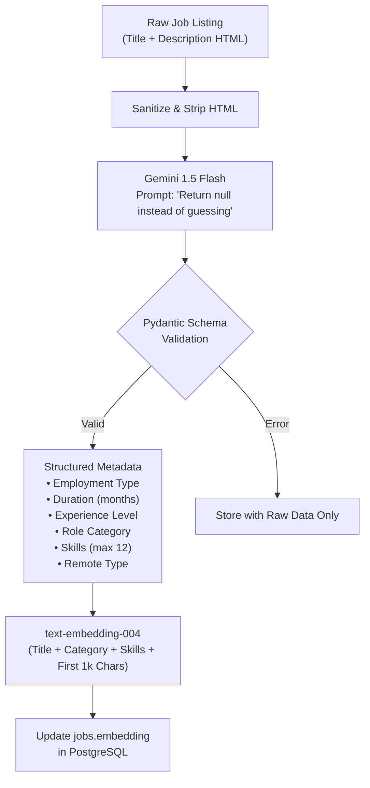
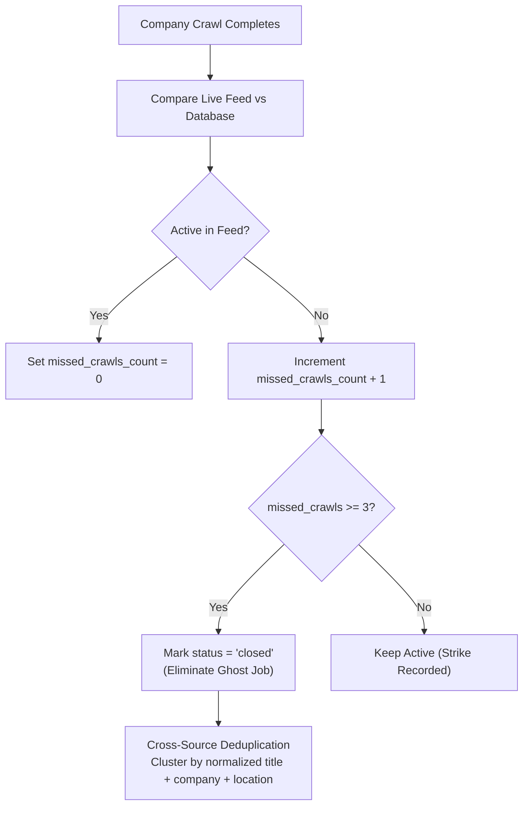
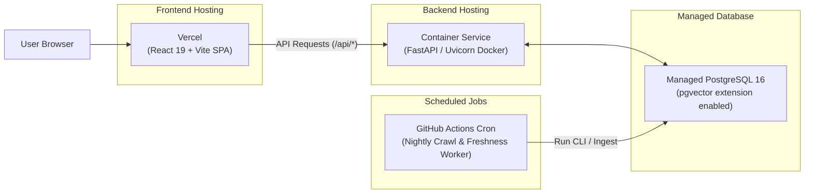

# Sift

> **The jobs nobody posts.** A polite, AI-enriched job-discovery engine that aggregates openings directly from company career pages and ATS platforms, enriches them with LLMs, and lets users search in natural language with direct links to apply.

[](LICENSE)
[](https://www.python.org/)
[](https://fastapi.tiangolo.com)
[](https://www.postgresql.org/)
[](https://github.com/pgvector/pgvector)
[](https://react.dev/)
[](https://www.typescriptlang.org/)

---

## High-Level Architecture

Sift is split into an asynchronous crawler and enrichment pipeline feeding a high-performance hybrid search engine:



---

## Subsystem Flowcharts

### 1. Natural Language Search & Hybrid Ranking

How a natural language search query is parsed, evaluated with hybrid search, and returned to the user:



---

### 2. Polite Crawler Pipeline

Every external HTTP request adheres strictly to polite crawler ethics:



---

### 3. AI Enrichment Pipeline

Raw job descriptions are enriched with structured metadata using Gemini 1.5 Flash in JSON mode:



---

### 4. Job Expiry & Deduplication (3-Strike Rule)

Keeping the index clean of ghost jobs and duplicate postings across syndication networks:



---

### 5. Deployment Architecture (Planned)

Target production topology with zero server maintenance overhead:



---

## Tech Stack

| Component | Technology | Rationale |
| :--- | :--- | :--- |
| **Frontend** | React 19, TypeScript, Tailwind CSS | Clean typography, editorial density, zero layout shift |
| **Backend API** | FastAPI, Python 3.12+, Uvicorn | Async I/O for high-concurrency ingestion and rapid search API responses |
| **Database & Vector** | PostgreSQL 16 + `pgvector` | Single source of truth combining relational ACID transactions with vector similarity |
| **AI / Structured Output** | Gemini 1.5 Flash | High throughput, strict JSON schema output, low latency |
| **Vector Embeddings** | Google `text-embedding-004` | 768-dimensional semantic representations for hybrid search |
| **Web Crawling** | HTTPX, BeautifulSoup4, Playwright | Polite async crawling, rate-limiting, and JS rendering when required |
| **Package Management** | `uv` (Python) & `npm` (Node) | Instant dependency synchronization and reproducible builds |

---

## Project Structure

```text
sift/
├── backend/
│   ├── app/
│   │   ├── ai/                 # Gemini enrichment, embeddings & query parser
│   │   ├── api/                # FastAPI routes (/search, /jobs, /filters, /admin)
│   │   ├── core/               # Settings, configuration & domain guardrails
│   │   ├── crawler/            # Polite crawler core, rate-limiter & robots parser
│   │   │   ├── connectors/     # Greenhouse, Lever, Ashby, and custom scrapers
│   │   │   ├── client.py       # Polite HTTP client with token bucket
│   │   │   └── robots.py       # Async robots.txt compliance checker
│   │   ├── db/                 # PostgreSQL models, pgvector migrations & session
│   │   ├── services/           # Hybrid search & maintenance services
│   │   ├── cli.py              # Administrative & crawler CLI commands
│   │   └── main.py             # ASGI entrypoint
│   ├── tests/                  # 50+ unit & integration tests
│   ├── Dockerfile              # Production container build
│   └── pyproject.toml          # uv project configuration
├── frontend/
│   ├── src/
│   │   ├── components/         # SearchBar, JobRow, FilterRail, Header, Drawer
│   │   ├── pages/              # LandingPage, SearchPage, SavedPage, AdminPage
│   │   ├── types/              # Strict TypeScript API definitions
│   │   └── index.css           # Editorial design tokens & typography
│   ├── package.json
│   └── vite.config.ts
├── docs/
│   └── design-system.md        # UI tokens, typography & crawler ethics manifesto
├── .github/workflows/          # CI, nightly crawl & enrichment pipelines
├── CONTRIBUTING.md             # Guide: Add an ATS connector in <50 lines
├── .env.example                # Safe environment template
└── README.md
```

---

## Local Development

### Prerequisites

- Python 3.12+ with [`uv`](https://github.com/astral-sh/uv)
- Node.js 20+ with `npm`
- PostgreSQL 16 with `pgvector` extension

### 1. Clone & Configure

```bash
git clone https://github.com/AdityaSurse/sift.git
cd sift
cp .env.example .env
```

### 2. Start Backend

```bash
cd backend
uv sync --extra dev
uv run alembic upgrade head
uv run uvicorn app.main:app --reload --port 8000
```

The API docs are available at `http://localhost:8000/docs`.

### 3. Start Frontend

```bash
cd ../frontend
npm install
npm run dev
```

The web application is available at `http://localhost:5173`.

### 4. Run Crawler & Maintenance CLI

```bash
cd ../backend

# Import seed company list
uv run python -m app.cli import-companies --csv-path data/companies_seed.csv

# Crawl all verified career pages
uv run python -m app.cli crawl --all --output-summary crawl_summary.json

# Enrich raw job postings with Gemini AI
uv run python -m app.cli enrich-and-embed --batch-size 50

# Run 3-strike ghost job expiry & deduplication
uv run python -m app.cli maintenance --missed-threshold 3
```

---

## Crawling Ethics

Sift is built on strict web citizenship principles:

1. **Strict Robots.txt Adherence**: Every domain's `robots.txt` is fetched, parsed, and cached. Any disallowed path is skipped immediately.
2. **Per-Domain Rate Limiting**: Minimum delay of 1.5 seconds between requests to the same host with a token bucket concurrency limit of 1.
3. **No Walled Gardens**: Sift **never** scrapes LinkedIn, Indeed, Glassdoor, or closed networks. We only index public ATS feeds and official career endpoints.
4. **Transparent Identity**: All HTTP requests identify clearly:  
   `User-Agent: SiftBot/1.0 (+https://siftjobs.com/bot; crawler@siftjobs.com)`
5. **Direct Apply Only**: Apply links always redirect users directly to the original career portal in a new tab. We never capture applicant data, lock jobs behind accounts, or monetize referrals.

---

## Contributing

See [CONTRIBUTING.md](CONTRIBUTING.md) for step-by-step instructions on implementing a new ATS connector in under 50 lines.

## License

This project is licensed under the [MIT License](LICENSE).
